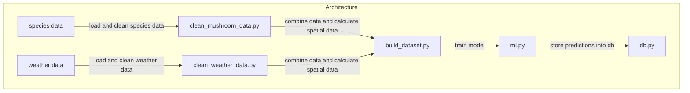

# findmushroom

This is data science project for helsinki universitys masters course. The application aims to predict different mushroom growth based on different features using logistic regression. 

### Installation
1. pull the repo ```git clone git@github.com:simkatti/funguslocus.git ```
2. go to the project root ```cd findmushroom```
3. create virtual enviroment ```python -m venv .venv``` (linux)
4. activate venv ```source .venv/bin/activate```
5. install requirements ```pip install -r requirements.txt```

### Running the app
1. ``` source .venv/bin/activate ``` 
2. ```uvicorn app.main:app --reload```

### Datasets used
[Mushroom data](https://laji.fi/en)

[Weather data](https://github.com/pnuu/fmiopendata)


### Architecture



